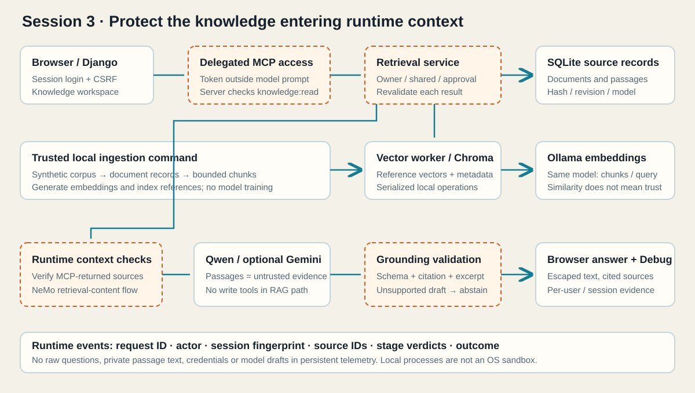

# Session 3 — RAG Security, Hallucinations and Runtime Defense

RAG is a key part of building useful business AI: it connects a model to an organization's current knowledge without retraining the model. This workshop extends the **Session 2 solution**, retaining the support portal, ticket application, authentication, delegated MCP grants, ownership checks, human confirmation, NeMo and the existing tests.

The new challenge is the **knowledge the assistant reads**. Students inspect embeddings and semantic search, poison a synthetic knowledge base, and repair document access, provenance, runtime content checks and answer grounding. Document content and MCP results remain untrusted evidence.

## Workshop materials

- [Codespaces setup](docs/GITHUB_CODESPACES_SETUP.md) / [local setup](docs/LOCAL_SETUP.md)
- [Exercises and timings](docs/EXERCISES.md) / [instructor guide](docs/INSTRUCTOR_NOTES.md)
- [Attack cases](docs/ATTACK_PROMPTS.md) / [student evidence](docs/NOTES_TEMPLATE.md) / [corpus teaching notes](docs/CORPUS.md)
- [Architecture and threat model](docs/THREAT_MODEL.md)
- [Curriculum coverage](docs/SCOPE_AND_EVIDENCE.md) / [verification](docs/VERIFICATION.md) / [local validation](docs/VALIDATION.md)
- [Offline slides](session3_workshop_deck.html)
- [RAG concepts and framework](docs/RAG_FRAMEWORK.md)

## Distribution pattern

Distribute `starter/`; keep `solution/` as the instructor answer key. Both copies begin with all Session 2 ticket repairs. The starter deliberately omits four **new** RAG controls in `knowledge/controls.py`, uses a weak RAG policy prompt, and has the retrieval NeMo flow disabled. The solution includes the repairs. The tests are identical; security tests intentionally fail in the unchanged starter. There is no environment variable that turns the starter into the solution.

## System architecture



## Knowledge storage

The PDF files remain on disk in `knowledge/corpus/`. Neither command stores the PDF binary in SQL.

| Command | Storage populated | Contents |
|---|---|---|
| `python manage.py seed_knowledge` | SQLite: `knowledge_document` | Extracted full text (`body`), page text and numbers (`source_pages`), title, source filename/checksum, revision, ownership, visibility and approval. One row per document. |
| `python manage.py index_knowledge` | SQLite: `knowledge_passage` | Creates text chunks with source page numbers, embedding vectors and model identifiers. |
| `python manage.py index_knowledge` | Local Chroma index | Passage vectors, IDs and reference metadata used to rank search candidates. Authoritative passage text and permissions remain in SQLite. |

`seed_knowledge` reads existing users from `auth_user` to assign private-document ownership; it does not create or update users. Exact tokens searches the original page text in `knowledge_document` immediately after import. Run the index command to enable Semantic search.

Find the command implementations at `knowledge/management/commands/seed_knowledge.py` and `knowledge/management/commands/index_knowledge.py`. Their Django models are in `knowledge/models.py`; chunking and embedding orchestration are in `knowledge/ingestion.py`. These paths exist in both `starter/` and `solution/`.

## Project organization

```text
.devcontainer/                 Same Python 3.12 / Ollama / private port setup
.github/workflows/security.yml CI checks both workshop states
docs/                          Student and instructor evidence-driven guides
starter/                       Participant application
solution/                      Instructor answer key
  manage.py
  support_portal/               Django settings, main URLs, theme
  tickets/                      Inherited application and permissions
  chatbot/                      Inherited assistant, consent and MCP client
  knowledge/                    New Django app
    models.py                   Documents, passages, privacy-conscious runtime events
    ingestion.py                Chunking and embedding
    embeddings.py               Ollama embeddings; explicit demo fixture
    vector_store.py             Local persistent Chroma, cosine distance
    vector_worker.py            Serialized, bounded index operations
    retrieval.py                Shared website/MCP search service
    controls.py                 Four focused student repairs
    generation.py               Qwen text answers and Gemini/Demo structured answers
    grounding.py                Exact-excerpt source validation
    pipeline.py                 Runtime checks and telemetry
    corpus/                     Clean and poisoned source PDFs; metadata-only manifest
    management/commands/        Seed, index and embedding-inspection commands
    templates/knowledge/        Portal-consistent knowledge workspace
  mcp_server/server.py          Existing ticket tools plus search_knowledge
  guardrails/                   Existing rails plus retrieval Colang flow
  security/                     Existing delegated grant and redaction controls
  tests/                        Existing tests plus RAG tests
  scripts/                      Setup, tests, real-process checks, evaluation and SAST
```

One Django server contains all three apps. The root URL still opens Tickets. **Assistant** handles tickets and answers support questions from the knowledge base. **Knowledge** compares Exact tokens and Semantic search at `/knowledge/` and displays ranked sources. Ordinary tickets still work without a model, MCP or assistant grant. Knowledge retrieval through the assistant requires the new `knowledge:read` permission.

## Quick start after setup

From the repository root in Codespaces:

```bash
cd starter
source .venv/bin/activate
python manage.py runserver 0.0.0.0:8000
```

Sign in and follow Exercise 2 to import documents and build the semantic index. Use **Knowledge** to compare Exact tokens and Semantic search with the same query. For an answer based on the retrieved text, grant **Search my permitted knowledge base** in Authorization and ask `How do I recover my account?` in **Assistant**. Its Debug panel shows the retrieved evidence, model prompts and runtime checks.

Default embeddings use `embeddinggemma:300m` through Ollama; Qwen remains the default answer model. Chroma is local, needs no account or separate service, and never chooses an embedding model implicitly. Explicit Demo embeddings and responses are labeled fixtures; they do not establish live-model behavior.

The Assistant answers in natural language. Expand **Sources** beneath a reply to see the retrieved passages and their filenames and pages. Compare the answer with those passages to check its accuracy. The lab changes retrieved context, not model weights.

Vector index operations run in a bounded local worker with a cross-process lock. Each worker exits after one Chroma operation, releasing embedded-engine handles before ingestion, Django or MCP opens the same index again. This requires no additional service or port.
