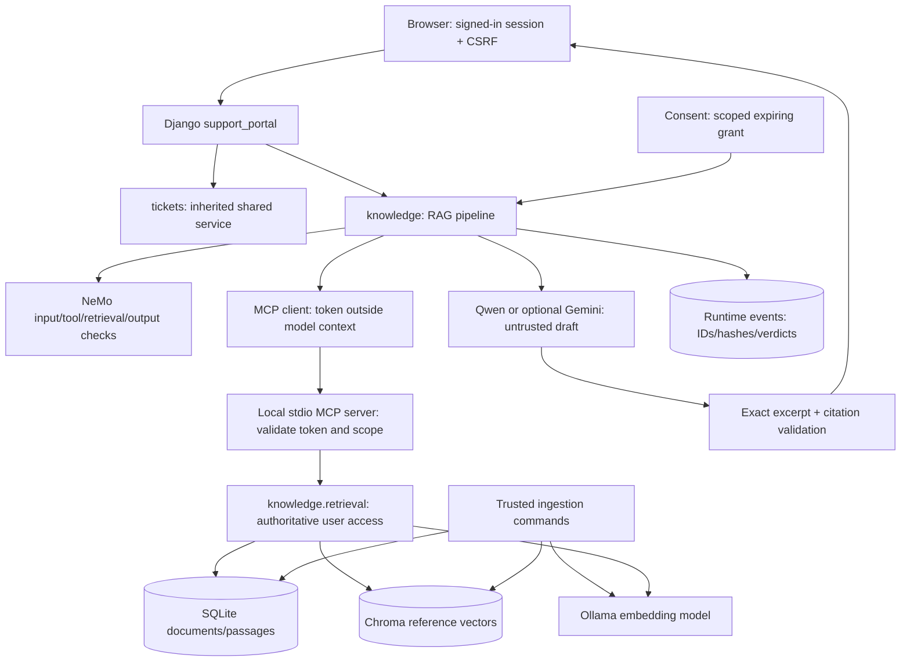

# Architecture and trust boundaries

Assets: private documents, grants, source integrity, trustworthy evidence, isolated sessions and useful legitimate answers. Threat actors can write a synthetic unreviewed document, edit retrieved text/metadata, request another user's content, or supply misleading model/tool outputs. They cannot make text into a trusted permission decision.

## Boundaries and controls

| Boundary | Threat | Solution control |
|---|---|---|
| Website → assistant | Login mistaken for delegated permission | Existing grant validation plus knowledge:read |
| MCP caller → server | Bypass website or forge actor | Independent token/scope validation; no user_id argument |
| Index → authoritative data | Forged metadata or stale vector | SQL prefilter + per-result owner, approval, revision/model/hash checks |
| MCP output → prompt | Fake sources, text substitution, indirect instructions | Rehydrate source IDs against SQL; compare text/metadata; retrieval rail |
| Context → model | Retrieved instructions gain authority | Untrusted-evidence policy, read-only workflow |
| Model → browser | Hallucinated claim or citation | Strict schema, exact excerpts, citation membership, escaped templates |
| One user/session → another | Shared cached retrieval or history | Per-request retrieval; browser-local last turn; actor-filtered events |
| Runtime → logs | Lost evidence or content/credential leakage | Request ID, source IDs, hashes, verdicts; no raw content in events |

Local process separation is not an OS sandbox. MCP/NeMo/Chroma run under the host account. A compromised host can read SQLite, `.env` or vectors. Vectors/metadata may reveal information and are ignored by Git, not encrypted. Encryption at rest and production deployment hardening are discussion topics, not implemented guarantees.

The corpus loader is a trusted local instructor/developer command, not a public upload API. No network URLs in documents are fetched. Public file-upload handling, arbitrary repository scanning and training/weight poisoning are outside this session.

Vector index operations run in a bounded local worker with a cross-process lock. Each worker exits after one Chroma operation, releasing embedded-engine handles before ingestion, Django or MCP opens the same index again. This requires no additional service or port.
